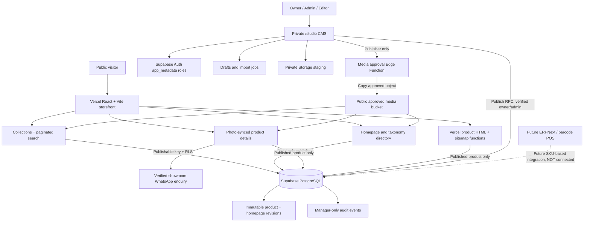

# Noman Brothers — Website, CMS, publishing & payment architecture

> **Source audit:** 7 November 2026 · AGM candidate development branch.
>
> **Status:** The current Vercel production deployment uses the original `main` React/Firebase storefront at commit `0691a7f`. This document describes the **unmerged next-generation React/Supabase candidate**, not an already-launched system. This candidate has CI-tested source code but no connected dedicated Noman Brothers Supabase environment, staged browser run, real-scale measurements, or client sign-off.

## 1. Purpose and scope

The store is a men's and children's ethnic/occasionwear showroom in Mandi Bazar, Warangal. The new website should help visitors **discover real garments**, browse by collection, inspect photos/videos, and **enquire/visit the showroom**. Staff should manage those pages via an authenticated CMS without writing code or publishing unapproved photographs.

Out of scope for this catalogue-first release: customer checkout, payment collection, delivery/order fulfillment, invoices, rewards, stock-on-hand, returns processing, GST accounting, barcode POS, or storefront customer accounts. Those are separate ERP/POS/ecommerce decisions, not hidden unfinished features of this release.

### System diagram



## 2. What currently runs on Vercel

**Live `main` — legacy Firebase implementation:** React/Vite UI with product catalogue, cart, shipping/COD/Card method choices, coupons, rewards, customer profiles and Firestore order records, plus an earlier PIN-based admin portal. It saves order data and opens WhatsApp; **the code reviewed does not show a verified payment gateway/capture/settlement or webhook reconciliation**. It even awards points on order initiation rather than confirmed payment. Do not interpret the UI's `Card` selection, "success" state, or "revenue" dashboard as evidence of money received.

**Candidate release — catalogue-first Supabase implementation:** the entire legacy checkout, order, rewards and PIN-admin UI is replaced with the private staff studio, public content display and showroom enquiry. Its optional `price` field is a merchandising field, not a payment ledger; it is not publicly displayed in the current design.

**Migration strategy:** preserve legacy `main` and current Vercel production deployment as rollback; verify actual deployed Firebase rules and export any approved historic records before retirement. The candidate is on stacked draft PR branches, not yet merged or deployed. Do **not** connect both backends to the same live application without a reviewed migration and explicit operational controls.

## 3. Frontend modules and request path

| Area | Primary source | Responsibility |
| --- | --- | --- |
| Route composition | `src/App.tsx`, `src/storefront/history.ts` | Accessible navigation, homepage, product, collection, search, contact, isolated studio route |
| Global design | `src/index.css`, `src/components/V2Header.tsx`, `V2Footer.tsx` | Typography, navigation, mobile menu, accessible states |
| Homepage | `src/components/V2Home.tsx`, `V2HomeDiscovery.tsx` | CMS-approved hero/department photos, premium collection directory and quick links |
| Collections | `src/components/V2Collection.tsx`, `src/storefront/navigation.ts` | Fixed men/kids taxonomy, category art, related categories, paginated 24-item public results |
| Product details | `src/components/V2Product.tsx`, `src/storefront/productTheme.ts` | Approved gallery, photo-synced blurred backdrop, product facts, video, verified WhatsApp enquiry |
| Public data | `src/lib/catalogQueries.ts`, `src/lib/cmsData.ts` | Published-only Supabase reads, product conversion, home and approved categories |
| Search/indexing | `api/product.ts`, `api/_seo.mjs`, `api/sitemap*.ts`, `scripts/prerender-categories.mjs` | Crawlable product/category HTML, structured metadata, published-only sitemap |
| Private studio | `src/components/CmsStudio.tsx`, `src/components/studio/*` | Staff sign-in, product drafts, media approval, homepage, collections, imports |
| Storage + imports | `src/lib/cmsUpload.ts`, `src/lib/importEngine.ts`, `src/lib/bulkCsv.ts` | Private image/video uploads, bounded CSV, retries, SKU matching and progress |

Public visitors do **not** receive the CMS's user password or privileged Supabase key. The browser uses `VITE_SUPABASE_URL` and a **publishable** `VITE_SUPABASE_PUBLISHABLE_KEY`, subject to RLS. No service-role/`sb_secret_*` key belongs in any `VITE_*` variable.

## 4. Backend responsibilities

**Supabase Auth:** owner, admin, and editor roles are assigned through privileged `app_metadata.nb_role`. Staff use /studio. The UI is not a security boundary; table grants, RLS, RPC checks and Edge Function authorization enforce access. Role revocation must be tested with real sessions/JWT expiration/revocation.

**PostgreSQL content:**
- `nb_categories`: fixed collection routes and CMS-managed labels/descriptions/banner art.
- `nb_products`: materialized *published* product records and stable SKU, description, images, optional price/video.
- `nb_product_categories` and `nb_product_media`: relational read-model for published associations.
- `nb_product_drafts` and `nb_product_revisions`: private edits and immutable numbered publish snapshots.
- `nb_home_drafts`, `nb_home_public`, `nb_home_revisions`: draft homepage, public version and history.
- `nb_media`: asset metadata and explicit approved flag.
- `nb_import_jobs`, `nb_import_rows`: owner-scoped CSV/photo batch status and reconciliation.
- `nb_audit_events`: restricted append-only operational event history.

**Storage:**
- `nb-media-staging` — **private** originals, upload by authorized staff; short-lived signed previews.
- `nb-media-public` — approved delivery copies, public URLs only after authorized promotion.
- `nb-media` — old bucket retained private, not the upload target.

**Functions and integrity:**
- `nb-media-approval` Edge Function checks fresh Auth role then copies/revokes media; failures require reconciliation.
- `nb_publish_product(uuid)` and `nb_publish_home()` verify staff role and approved asset URLs and atomically publish with immutable revisions.
- Database triggers guard direct published-table/revision writes, category banner approval and media revocation if a published page still references the file.
- Staff-only views and indexes support server-side paging; use real staging tests before making latency/scalability claims.

Database schema is applied through **nine ordered versioned migrations** on a *new, dedicated project*. No merchandise demo seed is included. SQL fixtures previously validated **13 application tables and 35 RLS policies** before the category-banner integrity migration (which adds a trigger, not an application table).

## 5. Publishing and version numbers

There are **three different kinds of versioning**:

| Version type | Example | Meaning | Changed by |
| --- | --- | --- | --- |
| Code release | Git commit SHA / reviewed PR / Vercel deployment | React, UI, server function and application logic | AGM development + approved release |
| Content revision | Product v1 → v2, Homepage v1 → v2 | New approved editorial snapshot; live public content updated without redeploy | Authorized CMS owner/admin via publish RPC |
| Database migration | Timestamped `.sql` files | Reproducible schema/security changes, independent of product edits | Reviewed migrations in isolated Supabase environment |

Example: the website may remain at one Vercel release SHA while the owner changes a product description and publishes **product version 4**. That content becomes visible through published data reads; **there is no requirement to redeploy React for a content edit**. A later UI release can change the design without rewriting product version history.

**Category banner/description changes currently write directly to the authorized category row and are audited; they do not yet have numbered category revisions.** This should remain visible in the owner operating model. There is no one-click rollback button for product/home versions in the current CMS: restoring historic content requires a reviewed new publication, not editing immutable revision rows. Code release rollback and content rollback are different procedures.

## 6. How enquiries and future payments relate

**Now:**
```
Visitor browses published product
→ opens approved photos/video
→ clicks verified WhatsApp enquiry or showroom directions
→ shop discusses price, fit and availability offline
→ website does NOT declare an order paid or issue a receipt
```

**Later, if the shop adopts ERPNext/Frappe and barcode POS:**
```
CMS/SKU identity → verified sync contract → ERPNext item master
ERPNext manages stock, pricing rules, tax, sales invoices, payment entries and receipts
POS scanner/printer works against the ERP system
Optional future website sales gateway:
  server-created order → verified payment-provider webhook → ERP invoice/payment event
  never a client-only "success" flag
```

Do not invent stock availability on the website. In a future integration, ERP/POS becomes **the financial and stock source of truth**, while the CMS remains a merchandising/editorial surface unless a reviewed migration explicitly changes ownership of product master records. Stable SKU is the bridging key; record cross-system IDs, conflict resolution, sync frequency, and refund reconciliation before implementation.

## 7. Infrastructure, branching and release flow

```
GitHub development feature branches
 → stacked reviewable PRs
 → locked Bun/TypeScript tests + PostgreSQL security fixtures
 → dedicated AGM Supabase staging project (NOT gym)
 → Auth/Storage/Edge/integration tests + real 10k/100k benchmark
 → ONE controlled Vercel staging deployment + mobile/SEO/404 smoke tests
 → verified backup/restore + client content and permissions
 → reviewer and owner exact-commit GO evidence
 → protected main + explicitly approved production release
```

Until client onboarding, do **not** use or migrate the unrelated gym Supabase project. Customer production accounts should be created in the customer's own organization; grant AGM scoped collaborator access, never request Gmail passwords/one-time codes.

Production `main` stays unchanged. Per-commit Vercel previews are suppressed by project settings/build-ignore rule. Keep one carefully controlled staging deployment only when integration testing is ready.

## 8. Production readiness ledger

| Gate | Evidence so far | Real acceptance still required |
| --- | --- | --- |
| Source code / CI | Passed on development PRs | Review and integrate stacked PRs into an approved release candidate |
| Frontend navigation and premium design | Automated component/router tests passed | Mobile and cross-browser visual QA, accessibility and Core Web Vitals |
| Product/home publishing | PostgreSQL fixture tests, version UI | Real Supabase owner/editor/revoked-role tests and actual published change |
| Media approval, image/video | Source and DB contract tests | Private byte access, Edge Function runtime, TUS resume, CDN, owner approval |
| Bulk CSV import | Bounded parser and fixture/contract tests | Real concurrency, recovery and 10k-row/100k-media staging workload |
| Payment safety | New catalogue has no checkout | Confirm store requirements; if ecommerce requested, design separately |
| SEO and Vercel | Prerender/SSR code and source tests | Real Vercel route, sitemap, 404, crawler and canonical verification |
| Data recovery | Operations runbook | Tested SQL **and** Storage restore to a different project |
| Project ownership | Client onboarding guide | Client-owned account, official domain/contact/photo rights and sign-off |
| Security of old site | Legacy code inspected | Review actual deployed Firestore rules and transition/rollback plan |

**Current status: not production-ready.** A green source CI is neither a real backend integration test nor payment authorization. See `docs/SUPABASE_STAGING_INSTALL.md`, `docs/SUPABASE_STAGING_TEST_MATRIX.md` and `docs/RELEASE_ACCEPTANCE.md`.
